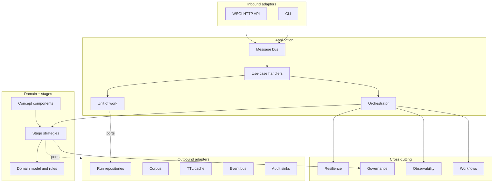
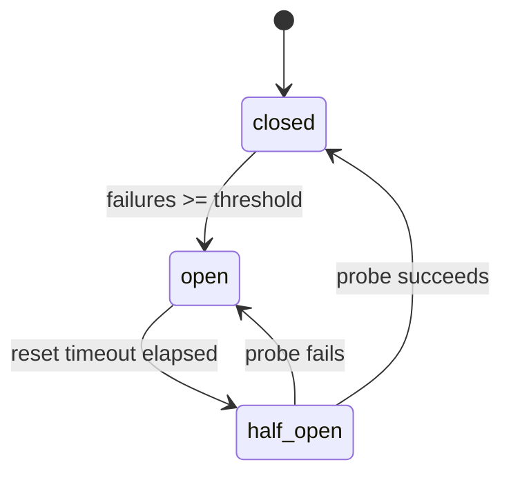
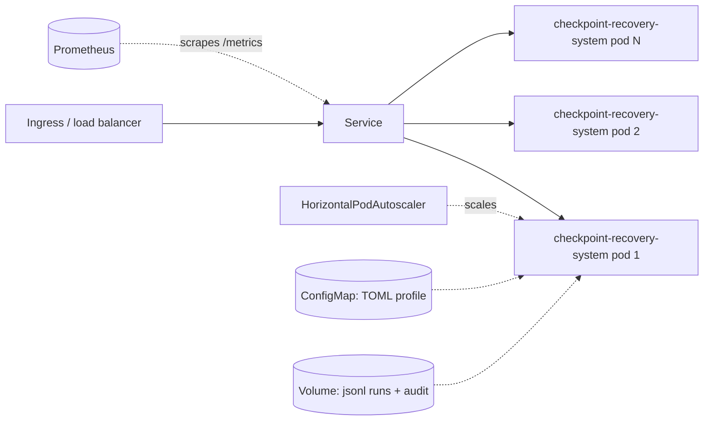

# Checkpoint Recovery System

Building a Robust Checkpoint Recovery System for LLM Training

[](.github/workflows/ci.yml)


This repository implements **Checkpoint Recovery System** as **Asynchronous Periodic Checkpointing with Atomic Writes**. The concept path centres on **Checkpoint Manager: Orchestrates the saving and loading of model states using a background thread to avoid blocking the main training process.**, **Storage System: A reliable and scalable storage solution that supports atomic file operations to ensure checkpoint integrity.**, and **Recovery Module: Ensures that the model can be restored to the exact state of the last verified checkpoint, including optimizer states and RNG seeds for reproducibility.**. In this design, scoring and ordering stay behind swappable ports, and candidates can be annotated without coupling to infrastructure. The runtime uses only the Python standard library, so every behaviour in this README can be run and tested on a laptop in seconds.

## Contents

- [Why this exists](#why-this-exists)
- [Architecture at a glance](#architecture-at-a-glance)
- [Pipeline stages](#pipeline-stages)
- [Components](#components)
- [Quick start](#quick-start)
- [HTTP API](#http-api)
- [Configuration](#configuration)
- [Governance model](#governance-model)
- [Resilience model](#resilience-model)
- [Observability](#observability)
- [Design trade-offs](#design-trade-offs)
- [Failure modes](#failure-modes)
- [Project layout](#project-layout)
- [Testing strategy](#testing-strategy)
- [Extending the pipeline](#extending-the-pipeline)
- [Deployment](#deployment)
- [Design integrity](#design-integrity)
- [Limitations](#limitations)

## Why this exists

LLM training runs are long and expensive. Interruptions (hardware failure, preemption, power loss) cause significant loss of compute time and money. The system must allow training to resume from the last verified state with minimal data loss and overhead.

A well-designed Checkpoint Recovery System is crucial for efficient LLM training. By choosing periodic checkpointing with asynchronous I/O and atomic writes, we minimize progress loss while managing storage and computational overhead effectively. The key is balancing the frequency of saves against the cost of storage and the impact on training throughput.

Most write-ups of Asynchronous Periodic Checkpointing with Atomic Writes stop at a box diagram. This repository goes further: every box is a module, every arrow is a port, and every failure mode named in the design has a test that injects it.

## Architecture at a glance

**Checkpoint Recovery System** follows **Asynchronous Periodic Checkpointing with Atomic Writes**.

Concept components and how they collaborate:

- **Checkpoint Manager: Orchestrates the saving and loading of model states using a background thread to avoid blocking the main training process.** (`score`): Blends upstream prior scores with query-aware relevance and reorders candidates.

- **Storage System: A reliable and scalable storage solution that supports atomic file operations to ensure checkpoint integrity.** (`enrich`): Annotates candidates with structural features and collapses exact duplicates.

- **Recovery Module: Ensures that the model can be restored to the exact state of the last verified checkpoint, including optimizer states and RNG seeds for reproducibility.** (`score`): Blends upstream prior scores with query-aware relevance and reorders candidates.

The service is hexagonal: inbound adapters (HTTP, CLI) drive an application bus; domain rules and stage strategies sit inside; outbound adapters implement ports for persistence, corpus access, caching, events, and audit. Only `container.py` wires concrete classes.



### Request flow

```mermaid
flowchart LR
    client([Client]) --> api[HTTP / CLI adapter]
    api --> bus[[Message bus]]
    bus --> orch{{Orchestrator}}
    orch --> s0["Intake<br/><i>ingest</i>"]
    s0 --> s1["Corpus Retrieval<br/><i>retrieve</i>"]
    s1 --> s2["Storage System: A reliable and scalable storage solution that supports atomic file operations to ensure checkpoint integrity.<br/><i>enrich</i>"]
    s2 --> s3["Ranking Cache<br/><i>cache</i>"]
    s3 --> s4["Checkpoint Manager: Orchestrates the saving and loading of model states using a background thread to avoid blocking the main training process.<br/><i>score</i>"]
    s4 --> s5["Recovery Module: Ensures that the model can be restored to the exact state of the last verified checkpoint, including optimizer states and RNG seeds for reproducibility.<br/><i>score</i>"]
    s5 --> s6["Graceful Fallback<br/><i>fallback</i>"]
    s6 --> s7["Access Policy<br/><i>policy</i>"]
    s7 --> s8["Token Budget Governor<br/><i>budget</i>"]
    s8 --> s9["Audit Recorder<br/><i>audit</i>"]
    s9 --> s10["Answer Assembly<br/><i>answer</i>"]
    s10 --> out([Outcome: answer or abstain])
    orch -.-> obs[(Metrics / traces / audit)]
    orch -.-> store[(Run repository)]
```



### Data flow

1. During training, the Checkpoint Manager asynchronously saves the model state at predefined intervals (e.g., every 1000 steps).
2. The Storage System securely stores these checkpoints using atomic write operations (write-to-temp, then rename) to prevent corruption.
3. In case of an interruption, the Recovery Module retrieves the latest valid checkpoint from the Storage System, verifies its integrity, and restores the model state to resume training seamlessly.

## Pipeline stages

For **Checkpoint Recovery System**, the default stage order is `intake`, `corpus_retrieval`, `storage_system_a_reliable_and_scalable_storage_s`, `ranking_cache`, `checkpoint_manager_orchestrates_the_saving_and_l`, `recovery_module_ensures_that_the_model_can_be_re`, `graceful_fallback`, `access_policy`, `token_budget_governor`, `audit_recorder`, and `answer_assembly`. Stages are ordered by role so ingest comes first, policy and budget gates sit before release, and answer assembly is last. Override the topology with `pipeline.stages` in any profile or `CHECKPOINT_RECOVERY_SYSTEM_PIPELINE__STAGES`.

| # | Stage | Role | Critical | Source |
|---|---|---|---|---|
| 1 | `intake` (Intake) | `ingest` | yes | built-in |
| 2 | `corpus_retrieval` (Corpus Retrieval) | `retrieve` | no | built-in |
| 3 | `storage_system_a_reliable_and_scalable_storage_s` (Storage System: A reliable and scalable storage solution that supports atomic file operations to ensure checkpoint integrity.) | `enrich` | no | [component](docs/components/storage_system_a_reliable_and_scalable_storage_s.md) |
| 4 | `ranking_cache` (Ranking Cache) | `cache` | no | [component](docs/components/ranking_cache.md) |
| 5 | `checkpoint_manager_orchestrates_the_saving_and_l` (Checkpoint Manager: Orchestrates the saving and loading of model states using a background thread to avoid blocking the main training process.) | `score` | no | [component](docs/components/checkpoint_manager_orchestrates_the_saving_and_l.md) |
| 6 | `recovery_module_ensures_that_the_model_can_be_re` (Recovery Module: Ensures that the model can be restored to the exact state of the last verified checkpoint, including optimizer states and RNG seeds for reproducibility.) | `score` | no | [component](docs/components/recovery_module_ensures_that_the_model_can_be_re.md) |
| 7 | `graceful_fallback` (Graceful Fallback) | `fallback` | no | built-in |
| 8 | `access_policy` (Access Policy) | `policy` | yes | built-in |
| 9 | `token_budget_governor` (Token Budget Governor) | `budget` | no | [component](docs/components/token_budget_governor.md) |
| 10 | `audit_recorder` (Audit Recorder) | `audit` | no | [component](docs/components/audit_recorder.md) |
| 11 | `answer_assembly` (Answer Assembly) | `answer` | yes | built-in |

## Components

| Component | Role | Responsibility |
|---|---|---|
| [Checkpoint Manager: Orchestrates the saving and loading of model states using a background thread to avoid blocking the main training process.](docs/components/checkpoint_manager_orchestrates_the_saving_and_l.md) | `score` | Blends upstream prior scores with query-aware relevance and reorders candidates. |
| [Storage System: A reliable and scalable storage solution that supports atomic file operations to ensure checkpoint integrity.](docs/components/storage_system_a_reliable_and_scalable_storage_s.md) | `enrich` | Annotates candidates with structural features and collapses exact duplicates. |
| [Recovery Module: Ensures that the model can be restored to the exact state of the last verified checkpoint, including optimizer states and RNG seeds for reproducibility.](docs/components/recovery_module_ensures_that_the_model_can_be_re.md) | `score` | Blends upstream prior scores with query-aware relevance and reorders candidates. |
| [Ranking Cache](docs/components/ranking_cache.md) | `cache` | Short-circuits repeated identical requests with a TTL-bounded ranking cache keyed by principal. |
| [Token Budget Governor](docs/components/token_budget_governor.md) | `budget` | Enforces per-request and global token ceilings before evidence reaches the answer stage. |
| [Audit Recorder](docs/components/audit_recorder.md) | `audit` | Writes a hash-chainable audit record for every run, including denials and degradations. |

Concept modules for **Checkpoint Recovery System** live under `src/checkpoint_recovery_system/components/` (`checkpoint_manager_orchestrates_the_saving_and_l/`, `storage_system_a_reliable_and_scalable_storage_s/`, and `recovery_module_ensures_that_the_model_can_be_re/`). Each folder owns its config, port, service, validators, models, metrics, errors, and registry adapter.

## Quick start

```bash
python -m venv .venv && source .venv/bin/activate
pip install -e ".[dev]"
make test
python -m checkpoint_recovery_system describe
python -m checkpoint_recovery_system run examples/requests/governed_query.json
python -m checkpoint_recovery_system serve --port 8080
```

Library use for **Checkpoint Recovery System**:

```python
from checkpoint_recovery_system import build_container
from checkpoint_recovery_system.application.commands import RunPipeline

container = build_container()
outcome = container.bus.handle(RunPipeline(request={
    "query": 'How does Checkpoint Recovery System address: Resume interrupted training with verified state?',
    "principal": {"subject": "alice", "roles": ["reader"], "groups": ["eng"]},
    "candidates": [{"doc_id": "a", "text": 'Resume interrupted training with verified state.', "score": 0.8}],
}))
print(outcome["status"], outcome.get("answer"))
```

## HTTP API

| Method | Path | Purpose |
|---|---|---|
| GET | `/healthz` | Liveness for **Checkpoint Recovery System** |
| GET | `/readyz` | Readiness (stages loaded, breakers closed, hooks healthy) |
| GET | `/metrics` | Prometheus exposition for this service |
| GET | `/v1/pipeline` | Stage topology for `checkpoint_recovery_system` |
| POST | `/v1/runs` | Execute a run of this pipeline |
| GET | `/v1/runs` | Recent run summaries |
| GET | `/v1/runs/{run_id}` | Full run record including checkpoints |

A run returns HTTP `200` when completed or abstained. Errors share one envelope: `{"error": {"code", "message", "details"}, "request_id"}`. Full reference: [docs/api/http.md](docs/api/http.md) and [docs/api/openapi.yaml](docs/api/openapi.yaml).

## Configuration

Configuration for **Checkpoint Recovery System** follows precedence: code defaults < TOML profile (`--config` or `CHECKPOINT_RECOVERY_SYSTEM_CONFIG`) < environment (`CHECKPOINT_RECOVERY_SYSTEM_<SECTION>__<KEY>`). Unknown keys are rejected at startup.

Knobs that matter most for this design: `CHECKPOINT_RECOVERY_SYSTEM_PIPELINE__TOP_K`, `CHECKPOINT_RECOVERY_SYSTEM_CACHE__ENABLED`, `CHECKPOINT_RECOVERY_SYSTEM_BUDGET__DEFAULT_TOKENS`, and `CHECKPOINT_RECOVERY_SYSTEM_GOVERNANCE__REDACT_PII`.

```bash
CHECKPOINT_RECOVERY_SYSTEM_PIPELINE__TOP_K=5 CHECKPOINT_RECOVERY_SYSTEM_CACHE__ENABLED=false python -m checkpoint_recovery_system config
```

Profiles: [`config/default.toml`](config/default.toml), `development.toml`, `production.toml`, `test.toml`. Reference: [docs/api/configuration.md](docs/api/configuration.md).

## Governance model

Governance for **Checkpoint Recovery System** is enforced by the stages in this pipeline (`audit`, `budget`, and `policy`).

- **Operation authorization:** callers need `run:create` before they can drive **Checkpoint Recovery System**.
- **Fail-closed access policy:** tenant, clearance, and ACL checks deny by default; if the policy stage fails, no candidate survives.
- **PII redaction:** e-mail, phone, SSN, and card numbers are redacted before text reaches answer assembly in **Checkpoint Recovery System**.
- **Budgets:** per-request token budgets are bounded by a hard ceiling before evidence is released.
- **Audit trail:** every run appends a redacted record with a verifiable hash chain.
- **Evidence-backed release:** answer assembly abstains when surviving evidence is insufficient for **Checkpoint Recovery System**.

Details: [docs/architecture/governance.md](docs/architecture/governance.md), [docs/architecture/security.md](docs/architecture/security.md).

## Resilience model

**Checkpoint Recovery System** treats `intake`, `access_policy`, and `answer_assembly` as critical (failure stops or fails closed). Non-critical stages such as `corpus_retrieval`, `storage_system_a_reliable_and_scalable_storage_s`, `ranking_cache`, `checkpoint_manager_orchestrates_the_saving_and_l`, and `recovery_module_ensures_that_the_model_can_be_re` degrade and continue when possible.

| Mechanism | Scope | Behaviour for this service |
|---|---|---|
| Circuit breaker | per stage | closed → open after N failures → half-open after reset |
| Retry | per stage call | exponential backoff, retryable errors only |
| Deadline | per stage | overruns are flagged in events and metrics |
| Bulkhead | per process | rejects work beyond the in-flight limit |
| Rate limiter | per tenant | token bucket on mutating HTTP calls |
| Fallback | pipeline | restores prior-score order when a non-critical stage degrades |



Details: [docs/architecture/resilience.md](docs/architecture/resilience.md).

## Observability

Observability is first-class for **Checkpoint Recovery System**:

- Structured JSON logs with run and request ids.
- In-process tracing with nested spans (`run` → `stage:<name>`).
- Prometheus metrics: `pipeline_runs_total`, `stage_executions_total`, `stage_duration_ms`, plus `component_checkpoint_manager_orchestrates_the_saving_and_l_runs_total`, `component_storage_system_a_reliable_and_scalable_storage_s_runs_total`, and `component_recovery_module_ensures_that_the_model_can_be_re_runs_total`.
- Per-stage checkpoints stored with every run record.
- Domain events on an internal bus (`run.started`, `run.completed`, `run.abstained`, `run.failed`, `stage.degraded`, and `candidate.denied`).

## Design trade-offs

See [docs/trade-offs.md](docs/trade-offs.md).

The structural decisions are recorded as ADRs in [docs/adr/](docs/adr/).

## Failure modes


Per-stage behaviour in this repository:
| Stage | Role | On failure |
|---|---|---|
| `intake` (Intake) | `ingest` | Run fails; the request never reaches retrieval. |
| `corpus_retrieval` (Corpus Retrieval) | `retrieve` | Run degrades; supplied candidates (if any) continue. |
| `storage_system_a_reliable_and_scalable_storage_s` (Storage System: A reliable and scalable storage solution that supports atomic file operations to ensure checkpoint integrity.) | `enrich` | Run degrades; candidates continue without annotations. |
| `ranking_cache` (Ranking Cache) | `cache` | Run degrades; the request is treated as a cache miss. |
| `checkpoint_manager_orchestrates_the_saving_and_l` (Checkpoint Manager: Orchestrates the saving and loading of model states using a background thread to avoid blocking the main training process.) | `score` | Run degrades; fallback restores upstream prior order. |
| `recovery_module_ensures_that_the_model_can_be_re` (Recovery Module: Ensures that the model can be restored to the exact state of the last verified checkpoint, including optimizer states and RNG seeds for reproducibility.) | `score` | Run degrades; fallback restores upstream prior order. |
| `graceful_fallback` (Graceful Fallback) | `fallback` | Run degrades; ordering from the last healthy stage is kept. |
| `access_policy` (Access Policy) | `policy` | Run fails closed: no candidates survive, the run abstains with `policy_unavailable`. |
| `token_budget_governor` (Token Budget Governor) | `budget` | Run degrades; the answer stage still applies `top_k`. |
| `audit_recorder` (Audit Recorder) | `audit` | Run degrades; the answer is still returned and the gap is visible in metrics. |
| `answer_assembly` (Answer Assembly) | `answer` | Run fails with `stage_failure:<name>`. |

These behaviours are listed in [docs/failure-modes.md](docs/failure-modes.md) and exercised in `tests/integration/test_degradation.py`.

## Project layout

```text
src/checkpoint_recovery_system/
├── kernel/          # Result, errors, ids, clock, specification helpers
├── config/          # typed settings, TOML + env loader
├── domain/          # entities, policies, and invariants for Checkpoint Recovery System
├── ports/           # protocols the core needs
├── stages/          # role strategies used by this pipeline
├── components/      # concept components for Checkpoint Recovery System
│   ├── checkpoint_manager_orchestrates_the_saving_and_l/     # Checkpoint Manager: Orchestrates the saving and loading of model states using a background thread to avoid blocking the main training process. (score)
│   ├── storage_system_a_reliable_and_scalable_storage_s/     # Storage System: A reliable and scalable storage solution that supports atomic file operations to ensure checkpoint integrity. (enrich)
│   ├── recovery_module_ensures_that_the_model_can_be_re/     # Recovery Module: Ensures that the model can be restored to the exact state of the last verified checkpoint, including optimizer states and RNG seeds for reproducibility. (score)
├── application/     # orchestrator, handlers, bus, unit of work
├── resilience/      # breaker, retry, deadline, bulkhead, rate limiter
├── governance/      # policy engine, budgets, RBAC, redaction
├── observability/   # logging, tracing, metrics, audit, health
├── workflows/       # run state machine and checkpoints
├── plugins/         # stage registry and lifecycle hooks
├── adapters/        # HTTP, CLI, and outbound adapters
├── container.py     # composition root
└── stage_catalog.py # default topology for checkpoint-recovery-system
tests/               # unit, integration, contract, property, e2e
docs/                # architecture, ADRs, components, runbooks, API
deploy/              # Kubernetes manifests and Helm chart
examples/            # sample requests and corpus for Checkpoint Recovery System
benchmarks/          # throughput and latency harness
```

## Testing strategy

| Layer | Location | What it proves for **Checkpoint Recovery System** |
|---|---|---|
| Unit | `tests/unit/` | each module in isolation with fake clocks and in-memory adapters |
| Component | `tests/unit/components/` | `test_component_checkpoint_manager_orchestrates_the_saving_and_l.py`, `test_component_storage_system_a_reliable_and_scalable_storage_s.py`, and `test_component_recovery_module_ensures_that_the_model_can_be_re.py` honour their contracts |
| Contract | `tests/contract/` | adapters satisfy ports; every registered stage honours the stage contract |
| Integration | `tests/integration/` | orchestrator, HTTP, CLI, budget exhaustion, degradation, and breaker behaviour |
| Property | `tests/property/` | seeded randomized requests never violate ordering or access invariants |
| Scenario | `tests/e2e/` | data-driven scenarios in `tests/fixtures/scenarios.json` |

```bash
make test
make test-fast
make bench
```

## Extending the pipeline

Register a new stage for **Checkpoint Recovery System** without touching the orchestrator:

```python
from checkpoint_recovery_system.plugins.registry import StageRegistry
from checkpoint_recovery_system.stage_catalog import register_all
from checkpoint_recovery_system.stages.base import Stage

class CheckpointSignal(Stage):
    role = 'score'
    def process(self, ctx):
        # project-specific enrichment for Checkpoint Recovery System
        for c in ctx.candidates:
            c.score += 0.01
        ctx.candidates.sort(key=lambda c: -c.score)

registry = StageRegistry()
register_all(registry)
registry.register('checkpoint_signal', 'score', lambda s: CheckpointSignal('checkpoint_signal', s), source="plugin")
```

Then add `'checkpoint_signal'` to `pipeline.stages`. See
[docs/guides/extending-stages.md](docs/guides/extending-stages.md) and
[examples/custom_stage_plugin.py](examples/custom_stage_plugin.py).

## Deployment

- Container image: [`Dockerfile`](Dockerfile) (non-root, health-checked) for `checkpoint_recovery_system`.
- Local stack: [`docker-compose.yml`](docker-compose.yml).
- Kubernetes: [`deploy/k8s/`](deploy/k8s/) (Deployment, Service, HPA, PDB, NetworkPolicy, ConfigMap).
- Helm: [`deploy/helm/checkpoint-recovery-system/`](deploy/helm/checkpoint-recovery-system/).



## Design integrity

Design decisions for **Checkpoint Recovery System** are recorded as ADRs under [docs/adr/](docs/adr/). The executable test suite in this repository is the authoritative check of runtime behaviour.

## Limitations

- The reference scorer is lexical (BM25-style). Production deployments should register a learned relevance model behind the same `RelevanceScorer` port.
- Persistence is in-memory or JSON Lines. Use a transactional store behind `RunRepository` for multi-replica deployments of **Checkpoint Recovery System**.
- The event bus and tracer are in-process. Bridge them to your platform's messaging and tracing systems via the provided ports.
- Budget accounting in the reference build is token-oriented; map monetary or tool-call ceilings onto the same budget port for production limits.

## License

MIT. See [LICENSE](LICENSE).
