# Data flow

1. During training, the Checkpoint Manager asynchronously saves the model state at predefined intervals (e.g., every 1000 steps).
2. The Storage System securely stores these checkpoints using atomic write operations (write-to-temp, then rename) to prevent corruption.
3. In case of an interruption, the Recovery Module retrieves the latest valid checkpoint from the Storage System, verifies its integrity, and restores the model state to resume training seamlessly.

```mermaid
flowchart LR
    client([Client]) --> api[HTTP / CLI adapter]
    api --> bus[[Message bus]]
    bus --> orch{{Orchestrator}}
    orch --> s0["Intake<br/><i>ingest</i>"]
    s0 --> s1["Corpus Retrieval<br/><i>retrieve</i>"]
    s1 --> s2["Storage System: A reliable and scalable storage solution that supports atomic file operations to ensure checkpoint integrity.<br/><i>enrich</i>"]
    s2 --> s3["Ranking Cache<br/><i>cache</i>"]
    s3 --> s4["Checkpoint Manager: Orchestrates the saving and loading of model states using a background thread to avoid blocking the main training process.<br/><i>score</i>"]
    s4 --> s5["Recovery Module: Ensures that the model can be restored to the exact state of the last verified checkpoint, including optimizer states and RNG seeds for reproducibility.<br/><i>score</i>"]
    s5 --> s6["Graceful Fallback<br/><i>fallback</i>"]
    s6 --> s7["Access Policy<br/><i>policy</i>"]
    s7 --> s8["Token Budget Governor<br/><i>budget</i>"]
    s8 --> s9["Audit Recorder<br/><i>audit</i>"]
    s9 --> s10["Answer Assembly<br/><i>answer</i>"]
    s10 --> out([Outcome: answer or abstain])
    orch -.-> obs[(Metrics / traces / audit)]
    orch -.-> store[(Run repository)]
```

The `PipelineContext` is the only mutable object in a run. Stages read the request,
mutate candidates, and append decisions. Nothing else carries run state.
